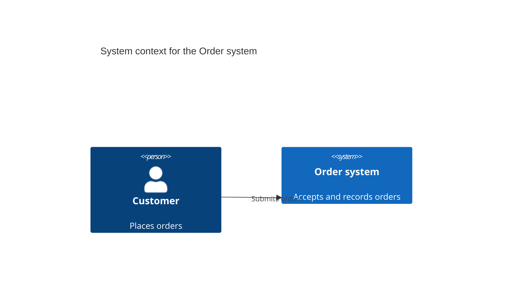
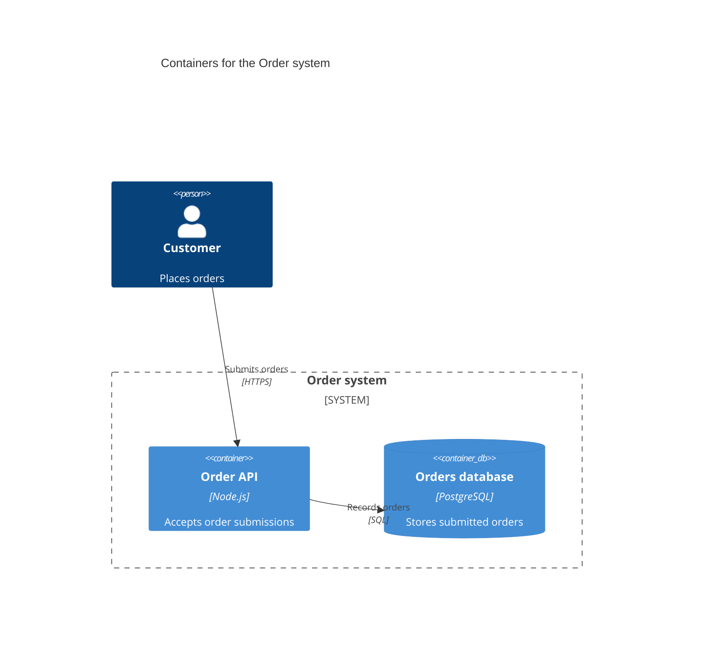
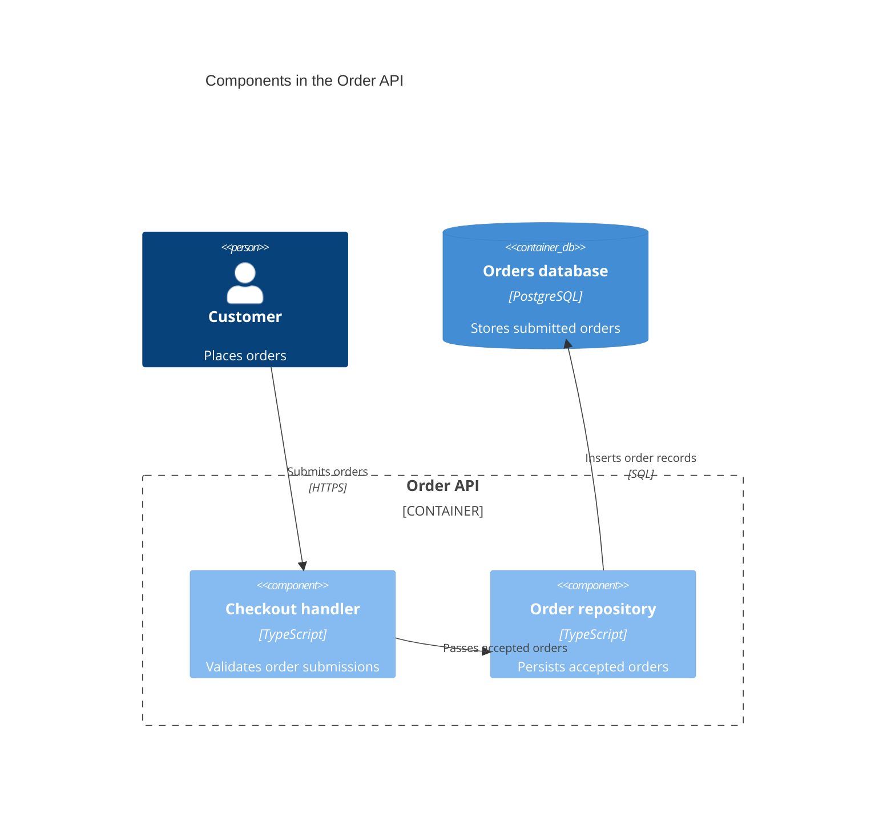

# C4 architecture with RealDocs

Use the C4 abstractions to explain the project's runtime architecture, then use RealDocs to publish the diagrams and link them to the relevant guides and code. [C4 abstractions](https://c4model.com/abstractions) · [Mermaid C4 syntax](https://mermaid.js.org/syntax/c4.html)

## Establish the scope

Work from the target project's documentation root. Read its instructions, existing architecture guides, and RealDocs config or docs script. Identify the system in scope, its users and external dependencies, and the runtime boundaries. Verify them against entry points, deployment and datastore configuration, and integration code. In a monorepo, follow runtime boundaries across packages. For a library, use a documented host application if the scope includes one. Describe unverified details as open questions and label proposed architecture separately from the current system.

| View | What to show | Mermaid syntax |
| --- | --- | --- |
| System context (L1) | One software system, its user roles, and directly connected external systems. Use language readers outside the engineering team can follow. | `C4Context` with `Person`, `System`, and `System_Ext` |
| Containers (L2) | The applications and data stores that make up that system, their responsibilities and technologies, and how they communicate. Keep relevant actors and external systems outside the system boundary. A C4 container is a runtime or storage boundary, so use evidence beyond package layouts or Docker definitions. | `C4Container` with `System_Boundary`, `Container`, and `ContainerDb` as appropriate |
| Components (L3) | Zoom into one container. Group related functionality behind meaningful interfaces and show its direct connections. Keep peer containers and external systems at their existing abstraction level. | `C4Component` with `Container_Boundary` and `Component` |
| Code (L4) | Zoom into one component only when implementation detail helps. Link to the generated API reference or document the relevant classes, interfaces, or functions. | Mermaid has no `C4Code` type. Use `classDiagram` or `erDiagram` when the code detail calls for it. |

Start with context and containers for a new overview. Add component or code views when the requested scope or a concrete reader question calls for them. Use `C4Dynamic` for a specific interaction and `C4Deployment` for an identified environment when those questions come up. [C4 diagram types](https://c4model.com/diagrams)

## Write the diagrams and guides

- Put each view in its own top-level `mermaid` fence. Start with the diagram type and a title that names the scope. Use unique, descriptive aliases within each diagram and consistent display names across views.
- Give elements short responsibility descriptions and name the technologies for containers and components. Use directed `Rel(from, to, "Action", "Protocol")` edges. Use a verb phrase that reads from source to target, and give the verified technology or protocol for communication between containers.
- Write a short Markdown key below each diagram to explain the elements, boundaries, and arrows. Use surrounding prose to explain the system's purpose, important interactions, and decisions or constraints that the diagram cannot convey. Link each detailed view from the relevant overview. [C4 notation and review guidance](https://c4model.com/diagrams/notation)
- Check the Mermaid syntax against the version used by the project. For crowded diagrams, reorder declarations or use `UpdateLayoutConfig` and `UpdateRelStyle` after inspecting the rendering. Use Markdown links for navigation.

## Publish and verify in the target project

1. Update the existing architecture guide or create `docs/architecture.md` if the project has no convention. Link the context and container views from the wiki homepage. Put a focused component view in its section guide or a source file's `@realdocs:file` overview.
2. Add new guide paths to top-level `pages` or `sections.<id>.pages` in `realdocs.json`, or to the project's repeated `--page` arguments. Preserve existing inputs. Use links relative to the Markdown or source file that contains them. Include the linked Markdown and JS/TS files in the documentation inputs so RealDocs can resolve headings and exports.
3. When a component maps to a documented JS/TS export, reuse its `@realdocs:docId` or add a stable unique ID. Put `{{ diagram.link('checkout', 'orders.checkout') }}` on its own line inside the Mermaid fence to generate a link beneath the diagram. Replace the alias and ID with the project's values. Keep component labels at the architecture level. Use the generated file map or `diagram.dependencies` as a companion view of code relationships.
4. Run the project's RealDocs check and HTML build with the same inputs. For a configured project, use `npx realdocs check --strict` and `npx realdocs build --strict --format html --out dist/realdocs-html`. Without a config, supply the same `--page` and any `--entry` arguments to both commands. Markdown-only projects can use `--page docs/architecture.md` on its own. If the installed CLI predates `realdocs.json` support, use its explicit inputs or the project's existing docs script.
5. Open the generated HTML wiki, follow the guide and code links, and confirm the Mermaid blocks render as diagrams. Review the boundaries, arrow directions, labels, and legibility. `check --strict` validates documentation inputs and references. The HTML renderer parses Mermaid when the page opens, so a successful build can still leave a diagram as source code. Report any rendering you could not verify.

## Example of zooming in

In this example, customers submit orders through a Node.js API, which records orders in PostgreSQL. In a real project, use names, technologies, and calls confirmed by the project's source and configuration.

**Diagram key.** The person is the customer. The system box represents the product they use. The arrow shows who submits the order.

**Diagram key.** The dashed outline encloses the Order system. The application box and database cylinder represent its containers. Arrows point from the caller to the target.

**Diagram key.** The dashed outline encloses the API's components. The database cylinder is a peer container. Arrows point from callers to the components or datastore they use.
