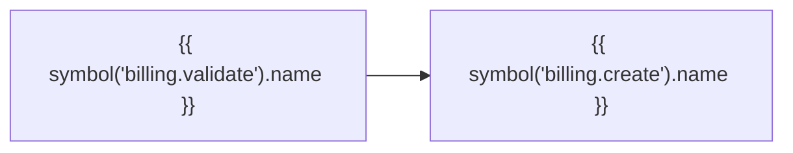
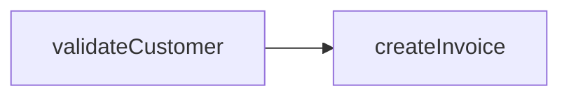
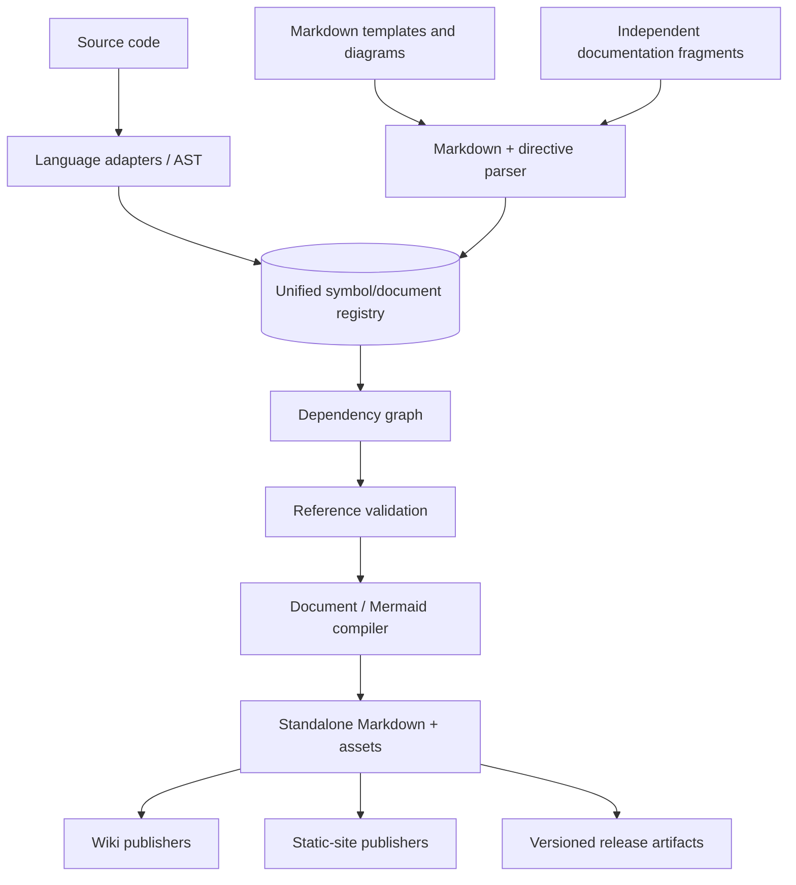

# Code-Coupled Documentation Compiler — Implementation Plan

> **Status:** Implementation planning reference (draft)
> **Version:** 0.1
> **Last updated:** 2026-11-25
> **Audience:** Developers and implementation agents
> **Working name:** `docsync` (placeholder; not a product or package name commitment)

## 1. Executive Summary

Build a **CLI-first, code-coupled documentation compiler** that extracts developer-authored documentation and information about symbols from source code, combines them with hand-authored Markdown templates, resolves semantic references, processes Mermaid diagrams that refer to code symbols, and emits **portable standalone Markdown** on demand or for each release. The compiled documentation may then be published to Git-hosted documentation sites, wikis, or other third-party destinations using optional publisher adapters.

The core value is *maintaining human-authored technical documentation alongside code*, not merely generating API reference pages. Documentation fragments, symbols, diagrams, architectural concepts, and relationships share a single, referenceable registry. Code renames, moves, and signature changes should update **generated facts** while preserving authored narrative. Semantically meaningful implementation changes should trigger a review warning rather than speculative prose rewrites.

**Architecture in one sentence:** source code + annotated documentation + Markdown/Mermaid templates -> extract -> index -> resolve -> validate -> render -> versioned Markdown -> optional publishers.

---

## 2. Goals and Guiding Principles

### 2.1 Confirmed requirements

1. **Code-coupled authoring:** write documentation information in the codebase near the code or concepts it documents.
2. **Reusable extraction:** extract those fragments and code information into a standalone document (e.g., `.md`).
3. **Semantic references:** reference symbols and fragments without hard-coding their current display names or source paths.
4. **Refactor resilience:** renames and moves should update generated names, links, signatures, and diagram labels when identity is preserved.
5. **Release builds:** compile documentation as a repeatable step on each software release; support versioned output.
6. **Portable outputs:** generated Markdown must be usable independently of the compiler and original source repository.
7. **Third-party publishing:** optionally create/update remote wiki or documentation pages.
8. **Mermaid as a first-class feature:** diagrams can reference code symbols and document entities; diagrams may also be generated from relationships.
9. **Human-written narrative:** author prose once and keep it intact; generated pieces refresh from code.
10. **Headless automation:** CLI and CI/CD usage first; no GUI required.

### 2.2 Strongly recommended principles

- **Reference everything through a common registry:** code symbols, documentation fragments, diagrams, modules, architectural components, and explicit relationships.
- **Separate identity from presentation:** stable `docId` is not the function name, title, file path, or published URL.
- **Prefer deterministic output:** identical inputs/configuration -> identical compiled artifact (excluding explicitly requested volatile metadata).
- **Do not silently invent semantics:** static analysis and author-declared relationships must be distinguishable.
- **Fail usefully:** a broken or ambiguous reference should have an actionable diagnostic, optionally fail CI, and never be silently redirected to a possibly unrelated symbol.
- **Keep the core independent from publishers:** build to a local output directory; publishing is a separate operation.
- **Do not require a hosted service:** all basic authoring, validation, generation, and preview work locally/offline.
- **Incremental when useful:** rebuild only affected outputs after changes, without sacrificing correctness.

### 2.3 Non-goals for the initial MVP

- Rewriting arbitrary prose using AI on every code change.
- Perfect automatic identification of a rename after the original stable ID disappears.
- Fully dynamic execution traces or guaranteed complete call graphs.
- A visual editor, hosted service, or mandatory web interface.
- Direct editing of arbitrary third-party wiki content without explicit managed regions or synchronization rules.
- Exact support for all programming languages in version 1.

---

## 3. User Workflows

### 3.1 Add code-coupled documentation

1. Developer annotates a source-code symbol with a stable ID, title, summary, group, and optionally references.
2. The code adapter parses language syntax and associates the annotation with an actual symbol.
3. The compiler records symbol identity, current name, signature, location, relationships, and authored fragments.
4. Markdown templates embed the information by semantic ID.
5. `docsync check` catches unresolved or ambiguous references; `docsync build` produces standalone Markdown.

### 3.2 Rename a function

1. `createInvoice` is renamed to `issueInvoice` through normal development/refactoring.
2. Its stable ID, e.g. `billing.create`, is retained.
3. The next compilation resolves the **same ID** to the **new current name**.
4. Generated text, signatures, Mermaid labels, and generated links are updated.
5. Authored prose that explicitly mentions the old name as ordinary text is **not** guaranteed to update; the tool may warn or provide opt-in lint rules.

### 3.3 Build and publish a release

1. CI checks out an immutable release tag/commit.
2. Runs documentation validation and compiler.
3. Writes `dist/docs/<version>/` with Markdown and referenced assets.
4. Stores release artifacts and/or publishes them through configured adapters.
5. The publish stage updates only managed content and reports changes/conflicts.

### 3.4 Use Mermaid diagrams

1. Developer writes a Mermaid block with semantic-reference expressions, or requests a generated diagram by reference.
2. The compiler parses the containing Markdown and Mermaid syntax; resolves references to stable registry entries.
3. It emits standard Mermaid source (with resolved labels and optional links) inside the compiled Markdown.
4. Destination adapters may instead emit SVG/PNG assets for platforms without Mermaid support.

---

## 4. Conceptual Data Model

Use a **documentation graph** with typed nodes and edges.

### 4.1 Node types

| Node type | Meaning | Typical attributes |
|---|---|---|
| `symbol` | Real program declaration | stable ID, language, qualified name, signature, source location |
| `fragment` | Authored documentation block | stable ID, title, Markdown body, group, provenance |
| `group` | Logical documentation grouping | stable ID, title, member IDs, optional ordering |
| `diagram` | Authored or generated diagram | stable ID, Mermaid source or generator definition |
| `component` | Architectural concept or service | stable ID, display name, description, linked symbols |
| `document` | Output document/page definition | stable ID, source template, route/output path |

### 4.2 Relationship types

- `documents`: a fragment explains a symbol or component.
- `belongs_to`: entity is a member of a group/module.
- `references`: template, fragment, or diagram references an entity.
- `uses` / `depends_on`: explicitly declared dependency.
- `calls`: compiler-derived or explicitly declared call edge.
- `inherits` / `implements`: language-resolved structural edge.
- `includes`: a document includes a fragment, group, diagram, or other document section.

For each relationship, record **provenance** (`source-annotation`, `static-analysis`, `template`, `manual-architecture`), source location, and confidence/limitations where relevant. Avoid presenting all edges as equivalent facts.

### 4.3 Stable ID rules

- Example IDs: `billing.create`, `billing.validate`, `billing.invoice-lifecycle`, `architecture.billing`.
- IDs must be unique within a namespace/project (or fully qualified when aggregating multiple projects).
- Stable ID is explicitly assigned and must not be automatically regenerated from the current symbol name during refactoring.
- A move or rename preserves identity only when the ID remains associated with the intended declaration.
- Duplicate IDs, orphaned references, and conflicting types should be compile errors.
- An ID can be explicitly deprecated or aliased to another ID, with diagnostics; silent heuristics should not be the default.
- Versioned builds resolve IDs against the source snapshot checked out for the release.

**Open design decision:** support both inline `@livedocs:docId` annotations and an external stable-ID mapping/manifest. MVP can require explicit inline IDs; the external mapping enables cleaner source code and more languages later.

### 4.4 Suggested intermediate representation (IR)

```json
{
  "id": "billing.create",
  "kind": "symbol",
  "language": "typescript",
  "name": "issueInvoice",
  "qualifiedName": "billing.issueInvoice",
  "signature": "issueInvoice(customerId: string): Promise<Invoice>",
  "source": {
    "file": "src/billing/invoices.ts",
    "startLine": 12,
    "endLine": 23
  },
  "fragments": ["billing.create.summary"],
  "relationships": [
    { "type": "uses", "target": "billing.validate", "provenance": "source-annotation" }
  ]
}
```

The IR should be serializable for debugging/caching but not require a database service.

---

## 5. Proposed Source Annotation Syntax

> **Status:** Illustrative DSL; exact syntax is an implementation decision. Do not claim these annotations already exist in TypeScript/Javadoc tooling.

### 5.1 TypeScript symbol annotations

```ts
/**
 * @livedocs:docId billing.create
 * @livedocs:docGroup billing.invoice-lifecycle
 * @livedocs:docTitle Creating an invoice
 * @livedocs:docSummary Validates and saves a new invoice.
 * @livedocs:docUses billing.validate
 */
export async function createInvoice(customerId: string) {
  validateCustomer(customerId);
  // ...
}

/**
 * @livedocs:docId billing.validate
 * @livedocs:docSummary Checks whether a customer is valid.
 */
export function validateCustomer(customerId: string) {
  // ...
}
```

The adapter must associate comments with the correct AST declaration; never infer a target purely from nearby text when the association is ambiguous. Compile may include name, qualified name, signature, symbol kind, file, line, exported status, and selected source excerpts.

### 5.2 Rich documentation blocks

Support longer Markdown fragments alongside metadata, e.g.:

```ts
/**
 * @livedocs:docId billing.create
 * @livedocs:docTitle Invoice creation
 * @livedocs:docBody
 * ## Validation
 *
 * The customer is validated before an invoice is saved.
 * See {{ symbol("billing.validate").name }}.
 * @livedocs:endDocBody
 */
export async function createInvoice(customerId: string) { /* ... */ }
```

**Implementation note:** decide how to escape `*/`, indentation, fenced blocks, and nested expression delimiters. An alternative is colocated `*.doc.md` files with front matter such as `docId` and `symbol` to preserve Markdown without comment-escaping issues. Supporting both forms is desirable; choose one minimal canonical form for MVP.

### 5.3 Free-standing architecture documentation

Architecture concepts should not need a matching function:

```ts
/**
 * @livedocs:docId architecture.billing
 * @livedocs:docKind component
 * @livedocs:docTitle Billing architecture
 * @livedocs:docGroup architecture
 * @livedocs:docRef billing.create
 * @livedocs:docRef billing.validate
 * @livedocs:docBody
 * The billing module coordinates validation and invoice creation.
 * @livedocs:endDocBody
 */
```

For this case, the parser must explicitly support independent module/file-level documentation declarations, not pretend they are attached to the next AST symbol. Another valid design is a dedicated `.docs.md` or manifest declaration.

---

## 6. Markdown Template and Reference Syntax

> **Status:** Proposed template expressions; NOT native Markdown syntax.

### 6.1 Example document template

File: `docs/invoices.md`

````md
# Invoice lifecycle

## Overview

{{ docs.group("billing.invoice-lifecycle") }}

## API

The entry point is {{ symbol("billing.create").name }}.

### Signature

{{ symbol("billing.create").signature }}

### Source code

{{ symbol("billing.create").source }}

### Validation description

{{ docs.fragment("billing.validate.summary") }}
````

### 6.2 Candidate directives

| Directive | Purpose | Output |
|---|---|---|
| `symbol(id).name` | Current display name | Inline escaped text/code |
| `symbol(id).qualifiedName` | Resolved qualified symbol name | Inline text/code |
| `symbol(id).signature` | Current signature | Code/text |
| `symbol(id).source` | Selected source excerpt | Language-tagged fenced block |
| `symbol(id).link` | Stable destination for symbol docs | Relative URL |
| `docs.fragment(id)` | Include authored fragment | Markdown AST content |
| `docs.group(id)` | Include group content | Ordered composed Markdown |
| `diagram(id)` | Include named diagram | Mermaid fence or asset reference |
| `diagram.dependencies(id)` | Create dependency diagram | Mermaid flowchart |
| `diagram.calls(id)` | Create limited call graph | Mermaid flowchart |
| `diagram.inheritance(id)` | Class/interface hierarchy | Mermaid class/flow diagram |
| `diagram.sequence(id)` | Author-declared operation sequence | Mermaid sequence diagram |
| `diagram.architecture(id)` | Architecture relationships | Mermaid flowchart/C4-style output |

Prefer a parsed expression grammar or tightly bounded directive evaluator over arbitrary script evaluation. Define safe escaping by context (Markdown text, code fence, Mermaid label, link URL).

### 6.3 Compose two ways

- **Template-led:** author a narrative Markdown page and selectively include symbol facts/fragments/diagrams.
- **Group-led:** annotate code, assign groups and order, then generate a standard page for each group automatically.

Support reusable fragments in multiple pages without duplicating the authored source. Define deterministic ordering (explicit `order`, then ID sort) and detect include cycles.

---

## 7. Mermaid Integration — First-Class Requirements

### 7.1 Labels resolved from symbols

**Input** in Markdown source:

````md

````

**Example compiled output** before a rename:

````md

````

When `createInvoice` is renamed to `issueInvoice` but keeps `billing.create`, the generated Mermaid label becomes `issueInvoice`. Existing human-authored diagram structure stays intact.

### 7.2 Links from diagram nodes to documentation

Proposed authoring convenience:

````md
```mermaid
flowchart LR
    A["{{ symbol('billing.validate').name }}"]
    B["{{ symbol('billing.create').name }}"]
    A --> B
    {{ diagram.link('A', 'billing.validate') }}
    {{ diagram.link('B', 'billing.create') }}
```
````

The Mermaid processor may compile link directives to Mermaid `click` instructions, using generated relative document URLs when Mermaid renderer/security settings permit. For destinations that disable `click`, retain labels and optionally supply links in a separate Markdown legend. **Do not assume Mermaid links work identically on every wiki.**

### 7.3 Generated diagrams

Use explicit graph relationships as source data:

```ts
/**
 * @livedocs:docId billing.create
 * @livedocs:docUses billing.validate
 * @livedocs:docUses billing.persist
 */
export function createInvoice() {}
```

Then embed:

```md
{{ diagram.dependencies("billing.create") }}
```

Compiler-generated relationship graphs should be deterministic; permit configurable direction, depth, node count, and inclusion/exclusion filters to prevent unreadable output.

### 7.4 Diagram generator categories

| Generator | Source of truth | Caveat |
|---|---|---|
| `dependencies` | Explicit `uses`/`depends_on` annotations and/or analyzable imports | May omit runtime dependency injection |
| `calls` | Language static analysis | Not exhaustive under reflection/dynamic dispatch |
| `inheritance` | Parsed language type model | Requires capable language adapter |
| `sequence` | Explicit ordered operation metadata | Must not infer runtime order solely from a call graph |
| `architecture` | Manually declared components/relations linked to symbols | An architectural view, not a measured runtime topology |

### 7.5 Mermaid processing and security

- Parse Mermaid code fences from the Markdown AST; avoid unsafe blind regular-expression replacements.
- Resolve reference expressions in Mermaid label/link contexts with the right quoting/escaping.
- Preserve developer-authored diagram layout and non-reference text.
- Validate produced Mermaid syntax using a renderer/parser in tests or an optional `docsync check --diagrams` command.
- Avoid injecting untrusted source text as Mermaid directives, URLs, HTML, or JavaScript.
- Optional SVG/PNG export should package assets with output; keep standard Mermaid fences as the default portable representation.

---

## 8. Compiler Design

### 8.1 Data flow



### 8.2 Suggested modules

1. **Project/config loader** — read root manifest, locate source files/templates, determine version and targets.
2. **Language adapters** — parse symbols, attach annotations, resolve qualified names/signatures, enumerate relationships.
3. **Fragment loader** — parse inline or standalone Markdown documentation declarations.
4. **Registry** — enforce global ID uniqueness, type constraints, aliases, provenance, and source references.
5. **Markdown/directive parser** — parse AST, track expression source spans, prevent arbitrary code execution.
6. **Mermaid processor** — resolve labels/links and generate diagrams from registry edges.
7. **Dependency graph** — map source/ID changes to affected output pages and diagrams.
8. **Validator** — unknown IDs, duplicate IDs, invalid syntax, include cycles, unsupported diagram links, export warnings.
9. **Renderer** — assemble Markdown, generate relative links, copy assets, make output self-contained.
10. **Output/version manager** — deterministic paths and manifests for versioned release builds.
11. **Publisher adapters** — Git-based sites/wikis, REST-based page platforms, version-aware updates.
12. **Cache/reporting** — fingerprints, incremental builds, diagnostics and diff reports.

### 8.3 Language support

**MVP:** TypeScript (optionally JavaScript through the same ecosystem).

- Use the TypeScript compiler API for precise symbol and signature resolution when possible.
- Tree-sitter is an option for generalized incremental parsing across many languages, but it alone does not give full semantic resolution, type-checker intelligence, or stable rename identities.
- For later languages consider native compiler APIs, LSP integrations, and parsers with varying capability levels.
- Design a capability interface: symbols/signatures are core; call graphs/inheritance/resolve-links may be optional features by language.

### 8.4 Compiler outputs

Suggested layout:

```text
dist/docs/
  1.4.0/
    index.md
    billing/
      invoices.md
    architecture/
      billing.md
    assets/
      ...
    docsync-manifest.json
```

Outputs must not retain unresolved template directives. All relative links and assets should be valid within the export root; generated source-code links may optionally point to a known release tag URL or local source snapshot if available.

---

## 9. Change Detection, Synchronization, and Versioning

### 9.1 Expected behavior by change type

| Change | Expected behavior |
|---|---|
| Symbol renamed, stable ID retained | Rebuild name/signature/diagram labels/links |
| Symbol moved to new file, stable ID retained | Update file/line/source links |
| Parameters/return type changed | Rebuild signature; flag affected narrative for review |
| Symbol deleted / ID missing | Error on active references; optional explicit deprecation policy |
| Documentation fragment changed | Rebuild all including pages |
| `uses` / dependency edge changed | Rebuild affected generated diagrams |
| Implementation logic changed without interface changes | Detect changed source region and report potentially stale dependent prose; do not auto-rewrite |
| Output route/slug changed | Recompute links; publisher handles moves/redirect policy |
| Release tag created | Produce immutable versioned build |

### 9.2 Incremental build mechanism

- Store hashes/fingerprints of source files, extracted entity definitions, templates, generated diagram specs, and compiler options.
- Build reverse dependencies: `changed symbol/fragment -> affected template sections -> affected output pages`.
- Rebuild only affected outputs during iterative development; ensure clean build and incremental build are byte-for-byte equivalent.
- On a release build, validate the entire registry even if only a few files changed.
- A code-only change can be reported in an impact diff even when the generated Markdown remains unchanged.

### 9.3 Refactor semantics and limitations

An explicit stable ID lets the generator resolve a renamed symbol **if the ID stays attached to it**. This is the primary supported mechanism; the compiler should not promise magical rename tracking when IDs are removed or code is completely rewritten. Optional IDE tooling could later preserve and update ID associations during refactors. Manual prose not written using semantic expressions cannot be guaranteed to rename automatically.

### 9.4 Versioned documentation

- Set version from a `--version` argument, release tag, or configuration.
- Build from the exact code revision of that release.
- Avoid embedding unpinned `main` links in historical docs; prefer tag- or commit-specific source links.
- Keep a manifest of IDs, output routes, and source commit per release for navigation, diffing, and optional redirects.
- Publishing should preserve past versions unless explicitly configured otherwise.

---

## 10. External Publishing

Publishing is an optional post-build stage. The output contract is standard Markdown/assets; each adapter translates it to the destination's capabilities.

### 10.1 Candidate adapters

| Target | Strategy | Important considerations |
|---|---|---|
| GitHub Wiki | Push rendered Markdown into the wiki's separate Git repository | Links, page naming, authentication, and version organization |
| GitBook | Git-sync a generated Markdown repository/folder | Navigation format, asset paths, conflict/ownership model |
| Confluence | REST API to create/update designated pages | Mapping IDs to page IDs, format conversion, API permissions and version conflicts |
| Mintlify / similar Git-based sites | Commit to docs repository or generated subtree | Platform-specific navigation and MDX extensions |
| Generic Git repository | Commit generated tree to branch, subtree, or separate repo | Easiest general-purpose adapter |
| Static-site generators | Consume local generated Markdown | No direct publishing integration required initially |

### 10.2 Update policy

- **Default:** generated pages are fully tool-owned; publisher can replace them deterministically.
- **Optional managed regions:** update only content between explicit markers on otherwise human-maintained pages.
- Preserve manually maintained content outside managed regions.
- Map stable `document` IDs to target page IDs/paths; never rely only on page titles for update identity.
- Support `--dry-run`, diff preview, idempotency, and safe retries.
- Report remote edits/conflicts rather than overwriting them silently.
- Track published content hashes and target revisions/ETags where API allows.
- Keep secrets in environment/secret manager, not project config.

### 10.3 Mermaid compatibility strategy

1. Prefer standard Mermaid code fences where supported.
2. If a target lacks Mermaid rendering, convert diagrams to SVG/PNG during publishing, add asset references, and ensure links degrade gracefully.
3. Keep exports self-contained; avoid external Mermaid APIs or externally hosted diagram services by default.

---

## 11. CLI and CI/CD Contract

### 11.1 Proposed commands

```bash
# Scan source and show discovered IDs

docsync scan

# Validate references, duplicates, includes, optionally Mermaid syntax

docsync check

# Show which docs are affected by changes

docsync diff --base origin/main

# Compile standalone Markdown

docsync build

# Compile a tagged version

docsync build --version 1.4.0 --out dist/docs/1.4.0

# Publish to configured target (safe trial first)

docsync publish --target github-wiki --dry-run

docsync publish --target github-wiki
```

CLI output should support human-readable diagnostics and optionally `--json` for CI/agent use. Exit non-zero on compiler errors. Be explicit about warning/error policy; `--strict` can escalate selected warnings.

### 11.2 Sample configuration (proposed)

```yaml
project: billing-service
sources:
  - src/**/*.ts
documents:
  - docs/**/*.md
version: git-tag
output: dist/docs
references:
  requireStableIds: true
  onMissing: error
mermaid:
  output: source  # source | svg | png
publishers:
  github-wiki:
    type: git-wiki
    repo: ${DOCSYNC_WIKI_REPO}
    mode: managed-pages
```

Configuration format, command-line names, and environment-variable expansion remain proposals until implemented. Support environment-based secrets without persisting credentials.

### 11.3 Suggested release pipeline

```text
checkout release tag
    -> install dependencies
    -> docsync check --strict
    -> docsync build --version "$RELEASE_TAG"
    -> upload versioned artifact
    -> [optional approval] docsync publish --target <target>
```

Consider a PR workflow running `docsync diff` and publishing a documentation impact report before merge, plus a release workflow for immutable outputs.

---

## 12. MVP Phases and Implementation Tasks

### Phase 1 — Core compiler (minimum viable product)

**Scope:** TypeScript symbol extraction; inline stable `@livedocs:docId` and `@livedocs:docSummary`; source metadata; basic Markdown templates; `symbol(id).name`, `.signature`, `.source`; reusable fragments; `check` and `build`; deterministic standalone Markdown.

**Tasks**

- [ ] Define ID grammar, entity IR, registry APIs, and diagnostic codes.
- [ ] Build TS AST adapter that associates tagged comments with declarations.
- [ ] Implement standalone fragment definition (minimal form) and group membership.
- [ ] Parse Markdown AST and restricted template directives.
- [ ] Resolve references, handle missing/duplicate IDs, and detect cycles.
- [ ] Render portable Markdown, code fences, assets and relative links.
- [ ] Add CLI with `scan`, `check`, and `build`.
- [ ] Add fixture projects, goldens, and CI tests.

**Acceptance tests**

- Rename symbol, retain `@livedocs:docId`: generated name/signature updates without editing template.
- Move symbol across files: generated source location changes while reference resolves.
- Missing/duplicate ID: actionable diagnostic and non-zero exit.
- Multiple documents include the same fragment, compiled consistently.
- Two clean builds of the same inputs are byte-identical.

### Phase 2 — Mermaid integration

**Scope:** resolve references inside Mermaid code fences, compile optional diagram links, generate basic dependency graphs, validate rendered syntax, portable fallback assets.

**Tasks**

- [ ] Detect Mermaid AST code blocks and reference source positions.
- [ ] Implement context-safe interpolation into labels/links.
- [ ] Implement `diagram.link` or equivalent semantic link syntax.
- [ ] Implement deterministic `diagram.dependencies` from explicitly declared edges.
- [ ] Add diagrams with stable IDs for reuse across pages.
- [ ] Validate output diagrams and handle publisher fallbacks.

**Acceptance tests**

- Rename symbol, retain ID: compiled Mermaid label changes automatically.
- Unknown symbol in diagram: contextual diagnostic with file/line.
- Directed graph generated from declared edges matches expected snapshot.
- Diagram containing special characters does not break syntax or inject directives.
- A target without Mermaid can receive a rendered diagram asset.

### Phase 3 — Change tracking and publishers

**Scope:** dependency-aware rebuilds, semantic impact reports, release versioning, Git-based wiki publisher, safe update mechanics.

**Tasks**

- [ ] Build reverse dependency graph and file/entity fingerprints.
- [ ] Implement `diff --base` and incremental compilation.
- [ ] Implement versioned release manifest and source links.
- [ ] Implement generic Git publisher, then GitHub Wiki adapter.
- [ ] Implement dry run, conflict detection, safe retries, managed pages.
- [ ] Add release CI template and sample repository.

**Acceptance tests**

- Edit one fragment: only dependent pages are marked affected.
- Clean and incremental builds generate identical output.
- Re-run publication unchanged: no content changes.
- Manual edits outside a managed region survive publication.
- Publishing conflict is reported instead of blindly overwritten.

### Phase 4 — Broader ecosystem (future)

- [ ] Java, Python, Go, and additional language adapters.
- [ ] Explicit architecture component modeling and reusable views.
- [ ] More diagram generators: inheritance, call graphs, authored sequence diagrams.
- [ ] Confluence REST and GitBook-oriented publishing adapters.
- [ ] IDE extension for navigating IDs and applying safe refactors.
- [ ] Documentation coverage and impact dashboards, without requiring GUI use.
- [ ] Optional review suggestions for prose affected by semantic changes.

---

## 13. Testing and Quality Strategy

### 13.1 Parser and registry tests

- Comments before exports, overloads, nested classes/methods, overload signatures, decorators, imports/aliases, multiple declarations.
- Duplicate IDs, malformed tags, orphaned module comments, case sensitivity, cross-file and cross-package references.
- ID aliasing/deprecation and intentionally removed symbols.

### 13.2 Template and rendering tests

- Markdown escaping, nested includes, include cycles, code fences containing literal `{{...}}`, intended directives vs literal text.
- Stable relative links across file moves, slug changes, folders, and versioned outputs.
- UTF-8, Unicode identifiers, CRLF/LF normalization, deterministic ordering, large documents.

### 13.3 Mermaid tests

- Interpolation inside Mermaid labels with quotes, newlines, brackets, and delimiter characters.
- `click` behavior under different destination policies; safe fallback.
- Graph generation when no edges, one edge, cycles, multiple components, or large graphs.
- Render validation and snapshot tests for output Mermaid text.

### 13.4 Publishing tests

- Diff/dry-run, new page, updated page, deleted/renamed route, conflicting remote edit, permission failure, partial network failure, retry idempotence.
- Managed-region preservation and destination-specific syntax handling.

### 13.5 Key metrics

- Reference resolution success and failure counts.
- Documents affected per code change.
- Incremental vs full build wall time.
- Clean vs incremental output equivalence.
- Number of potentially stale prose fragments flagged for review.

---

## 14. Architectural Decisions and Open Questions

### Decisions established from the concept

1. **Markdown is a primary, portable compiled output**, not merely an intermediate webpage representation.
2. **Mermaid references are resolved by the compiler**, not by Mermaid itself.
3. **Stable IDs are the baseline refactor-safety mechanism.**
4. **The tool is CLI/headless first**, offline for core operations.
5. **Publishing is decoupled** from extraction and compilation.
6. **Automated generated-fact updates are separate from semantic prose review.**
7. **One registry serves symbols, fragments, diagrams, architecture nodes, and document pages.**

### To finalize during implementation design

- Exact annotation syntax: JSDoc tags vs decorators vs colocated Markdown vs external manifest.
- Exact template syntax and allowed reference functions; avoid a general-purpose executable template language.
- How code snippets are selected: whole declaration, body, line range, named extract, redaction rules.
- Cross-project namespace convention and how package/version references resolve.
- How group ordering and automatic page generation are defined.
- Whether Mermaid node IDs should be auto-generated from stable IDs or authored by users.
- What documentation destinations/links to create for symbols without dedicated pages.
- How to represent multi-version symbols and redirects if an ID is deprecated/renamed.
- Language implementation choice for the CLI; TypeScript is pragmatic for a TS-first MVP but not required.
- Supported Markdown dialect(s), Mermaid renderer/version, and target capabilities matrix.
- Remote ownership model: generated pages only vs mixed manual/managed-region pages.
- Whether a separate internal documentation AST is needed beyond Markdown + registry IR.

---

## 15. Existing Tools and Prior Art to Study

The following tools cover **parts** of the intended design; do not assume any one solves the full specification.

| Tool | Relevant ideas | Gap relative to this project |
|---|---|---|
| [Swimm](https://swimm.io/) | Code-coupled documentation, linking docs to code changes | Product/workflow fit and independent CLI Markdown publishing need evaluation |
| [TypeDoc](https://typedoc.org/) + [typedoc-plugin-markdown](https://github.com/typedoc2md/typedoc-plugin-markdown) | TypeScript semantic symbols, API docs, `{@link}`-style references, Markdown output | Human-authored reusable documentation graph and rename-safe IDs need extra design |
| [DocFX](https://dotnet.github.io/docfx/) | UID-based cross-references and Markdown-centered documentation | Not a universal code-coupled compiler or arbitrary Mermaid symbol resolver |
| [Doxygen](https://www.doxygen.nl/) | Source annotations, `@ref` cross-links, multilingual API docs | Primarily API documentation generation |
| [mkdocstrings](https://mkdocstrings.github.io/) | Embed generated API docs into Markdown pages | Refactor-aware registry and diagram relationships not its core mission |
| [LikeC4](https://likec4.dev/) | Architecture-as-code, reusable relationships/views, Mermaid exports | Architectural entities are not automatically source-code symbols |
| [RepoDoc (research)](https://github.com/SYSUSELab/RepoDoc) | Repository knowledge graph, impact-aware documentation generation | Research-stage approach; suitability and guarantees require validation |
| [GitBook](https://www.gitbook.com/) | Git-backed Markdown documentation publishing | Destination rather than compiler core |
| [Confluence](https://www.atlassian.com/software/confluence) | Remote wiki pages through APIs | Destination rather than compiler core |
| [GitHub Wiki](https://docs.github.com/en/communities/documenting-your-project-with-wikis/about-wikis) | Git-backed wiki publishing | Destination rather than compiler core |

**Research lens:** separate *cross-reference resolution at build time*, *stable identity across refactoring*, *change-impact analysis*, *diagram-aware references*, and *publishing*. A tool may support one or two without supporting all five.

---

## 16. Implementation Agent Brief

> Implement a CLI-first code-coupled documentation compiler, working name `docsync`, following this plan. Build the smallest reliable vertical slice first: parse TypeScript source annotations with stable semantic IDs; index real AST symbols; compile authored Markdown templates into standalone Markdown using safe semantic-reference directives; validate every reference; and prove renaming/moving a declaration with its stable ID preserves generated references. Next, integrate Mermaid code fences so node labels and optional links resolve through the same registry. Preserve developer-authored narrative, distinguish authored and inferred dependencies, and keep publishing optional and separate from builds. All operations must work headlessly in a local repository and in CI. Use golden fixtures and deterministic output to validate behavior. Do not promise automatic updating of arbitrary human prose or guaranteed code semantics from static analysis.

### Initial repository structure (suggestion)

```text
docsync/
  packages/
    core/                  # IR, registry, validation, dependency graph
    adapter-typescript/    # TS AST/symbol adapter
    markdown/              # template parsing and Markdown rendering
    mermaid/               # diagram references and generators
    cli/                   # scan, check, diff, build, publish
    publisher-git/         # optional generic Git publisher
  examples/
    billing-example/
      src/
      docs/
      docsync.yaml
  tests/
    fixtures/
    snapshots/
  docs/
    architecture.md
    directive-spec.md
    annotation-spec.md
```

### MVP definition of done

The repository contains a runnable CLI, documented source syntax and template syntax, fixture project, tests, a README, and a reproducible demo in which:

1. A symbol annotation has a stable ID.
2. A Markdown page includes its current name/signature and a documentation fragment.
3. A Mermaid diagram references that same stable ID.
4. Renaming the symbol **without changing its ID** updates the compiled Markdown and Mermaid label.
5. Missing IDs fail validation with readable diagnostics.
6. A release build emits standalone Markdown with no unresolved references.

---

## 17. Future Enhancements Worth Considering

- **Documentation impact mode:** PR comments: “These 3 pages and 2 diagrams depend on the changed code.”
- **Rich entity relationships:** functions, types, HTTP endpoints, events, configuration keys, database entities, and architecture nodes in one graph.
- **Cross-repository federation:** stable namespace IDs for services whose docs compile into a central knowledge base.
- **Documentation-specific code navigation:** produce backlinks from symbol to all pages and diagrams that reference it.
- **IDE-assisted rename safety:** detect relocation/renaming and retain ID binding even when code is reorganized.
- **Plugin API:** add custom annotation tags, symbol adapters, diagram generators, Markdown transforms, and publishers.
- **Schema validation for docs:** required fragments for public APIs/services, policies for deprecated symbols, and release gating.
- **Optional AI review assistance:** suggest prose updates based on impacted symbols, with explicit human approval; never mutate authored explanation silently.

---

## 18. Summary

This project should be treated as a **documentation compiler backed by a semantic graph**, rather than a conventional API documentation generator. Its most distinguishing feature is a unified ID-based reference system shared by source code, human-authored documentation, Mermaid diagrams, and published pages. A TypeScript-first, deterministic CLI compiler with a safe Markdown directive language and a Mermaid processor provides a focused and testable first implementation. Release versioning and third-party publishing follow as independent layers.
