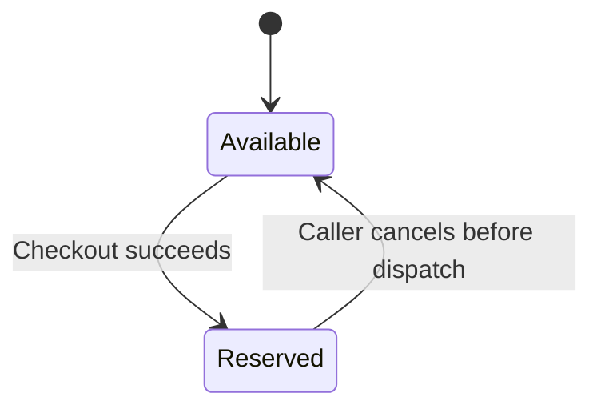

<!-- @livedocs:tag architecture -->
<!-- @livedocs:tag inventory -->
<!-- @livedocs:zone Decisions -->

# Reservation lifecycle decision

The example reserves inventory only after the order and shipping quote pass validation. A parcel that cannot be priced therefore leaves stock available. Once validation succeeds, the [inventory ledger](../../src/inventory.ts#doc-fulfillment.inventory) checks the complete request before deducting any units.

Each ledger instance keeps reservations in memory. The host owns durable storage, concurrent warehouse updates across processes, and communication with carriers. A real integration must decide how to reconcile stock when external dispatch has an uncertain outcome.

Read [cancelling an order](../warehouse.md#cancelling-an-order) for the example's reversal path and [carrier handoff](../delivery.md#carrier-handoff) for the caller boundary.
