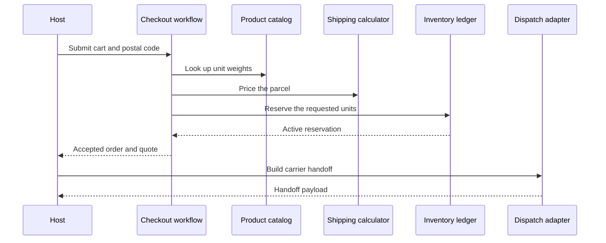

<!-- @livedocs:tag order-flow -->
<!-- @livedocs:tag public-api -->
<!-- @livedocs:zone Guides -->

# Host integration

## Checkout to handoff

The host supplies a cart and a postal code. [Checkout](../src/integrations/checkout.ts#checkout) builds the order and reserves stock. The [dispatch adapter](../src/delivery/dispatch.ts#createDispatchRequest) and [message formatter](../src/integrations/notification.ts#shipmentMessage) consume that completed result.

## Checkout dependencies

Follow the declared dependencies from checkout into the core shipment workflow.

{{ diagram.dependencies('fulfillment.checkout') }}

Use the [first shipment](quickstart.md) example to try the public API. The [delivery guide](delivery.md#carrier-handoff) covers responsibilities after checkout returns.
